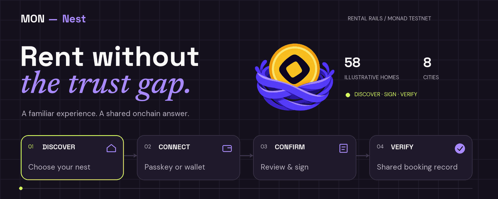
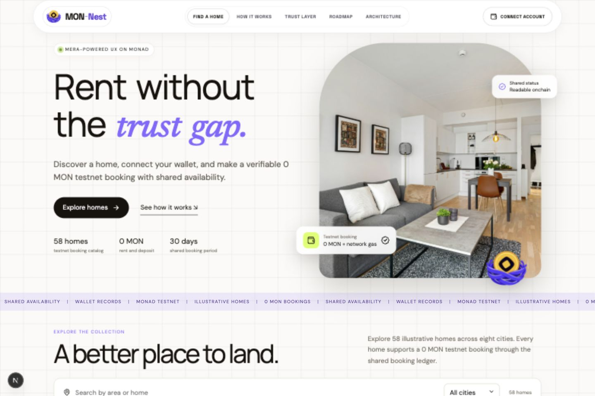
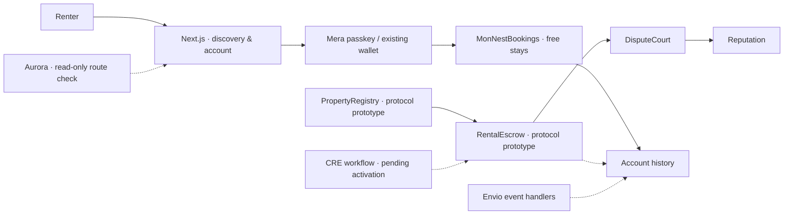

<div align="center">



**A familiar way to find a home. A verifiable way to book it.**

[Explore MON-Nest](https://mon-nest.vercel.app) · [The architecture](#under-the-surface) · [Run locally](#make-yourself-at-home) · [Demo walkthrough](docs/TECHNICAL_DEMO_SCRIPT.md)

[](https://github.com/Madxfury/MON-Nest/actions/workflows/ci.yml)    

<sub>The animation illustrates the booking journey; it is not a transaction feed. <a href="docs/media/rental-rails.png">View the still version.</a></sub>

</div>

---

## Less friction. More certainty.

Renting starts with an ordinary question: **can I trust what happens next?**

MON-Nest brings home discovery, passkey accounts, shared availability, and rent escrow into one interface. The current catalog uses a public booking ledger for 0 MON stays. A separate rental protocol contains escrow and dispute contracts for the longer-term product.

<table>
<tr>
<td width="33%"><strong>58 homes</strong><br/>An illustrative catalog with search, city filters, favorites, and image-to-detail navigation.</td>
<td width="33%"><strong>8 cities</strong><br/>A responsive collection designed for browsing on a phone or a desktop.</td>
<td width="33%"><strong>0 MON</strong><br/>Every catalog home is complimentary; network gas is paid separately.</td>
</tr>
</table>

<details>
<summary><strong>Take a look inside the product</strong></summary>
<br/>


The interface uses a restrained grid, custom brand typography, a compact feature ribbon, and a four-step bento layout. Home photos open their listing details; account and booking states stay visible throughout the journey.

</details>

## One journey. Four clear steps.

| Discover | Connect | Confirm | Verify |
| :--- | :--- | :--- | :--- |
| Browse a home and review its shared availability. | Create or recover a Mera passkey account, or connect an existing wallet. | Review the amount, recipient, and network gas before signing. | Check the receipt and the shared booking record. |

An active booking prevents another reservation until expiry. All 58 catalog homes are complimentary 0 MON stays configured for 30 days. The separate rental protocol contains monthly releases, deposit withdrawal, and dispute handling for future escrow flows. These are **Monad Testnet examples with illustrative properties**, not real tenancy offers.

## Under the surface



| Layer | What it does |
| :--- | :--- |
| **Next.js · React · TypeScript** | Catalog, listing dialogs, account views, and server API routes. |
| **Tailwind · reusable UI primitives** | Responsive bento cards alongside the site's custom CSS theme. |
| **Mera · viem** | Passkey signing, wallet transactions, simulation, and receipt handling. |
| **Solidity · Hardhat** | Booking availability, plus the property registry, escrow, dispute, and reputation prototypes. |
| **Envio** | Protocol event handlers and indexed account records, with chain-log history fallback. |
| **Alchemy · CRE · Aurora** | Optional RPC configuration, automation workflow code, and route capability checks. |

## Implementation checklist

The source and recorded deployment manifest are available for review. Live verification is tracked separately from implementation.

| Area | Current state |
| :--- | :--- |
| Discovery & interface | Responsive catalog, brand system, filters, favorites, pagination, and bento booking guide. |
| Account layer | Mera SDK and existing-wallet connection implemented; synthetic signing and recovery tests available. Real-device production passkey verification remains a release gate. |
| Monad contracts | Five contract addresses and deployment blocks recorded in [the manifest](src/deployments/monadTestnet.json). Verify current contract configuration and booking receipts on the target deployment. |
| Envio | Schema and event handlers implemented; hosted indexing and production queries require activation checks. |
| Alchemy | Server-side RPC adapter; an endpoint must be configured to activate it. |
| Chainlink CRE | Workflow and receiver code implemented; simulation and hosted activation pending. |
| Aurora Intents | Live read-only capability check. Cross-chain funding stays disabled until a supported testnet route and destination execution are verified. |

[Protocol and deployment details](docs/IMPLEMENTATION.md) · [Integration evidence](docs/SPONSOR_INTEGRATIONS.md) · [Threat model](docs/THREAT_MODEL.md)

## Make yourself at home

**Prerequisites:** Node.js 24 and npm. Passkeys require localhost or an HTTPS origin.

```bash
git clone https://github.com/Madxfury/MON-Nest.git
cd MON-Nest
npm ci
cp .env.example .env.local
npm run dev -- --webpack --port 3001
```

Open **http://localhost:3001**. Service credentials are optional for browsing. The app reads recorded testnet deployments from `src/deployments/monadTestnet.json`; environment variables override those values. The recorded ledger must be configured for the full 58-home catalog before every booking can be enabled. Transaction controls depend on available RPC access and verified contract state.

<details>
<summary><strong>Configuration & verification commands</strong></summary>

Use `.env.example` as the configuration reference. Alchemy and Envio credentials remain server-only. Passkeys on localhost and the deployed domain belong to separate accounts.

```bash
npm run build -- --webpack  # Production build and TypeScript checks
npm run wallet:test        # Deterministic signing, recovery, session teardown
npm run aurora:test        # Capability isolation, API failure and cache behavior
npm run contracts:test     # Solidity unit tests; first run downloads the compiler
```

The GitHub workflow runs the application build, wallet tests, and Aurora tests. Contract changes also require the Solidity suite. See [CONTRIBUTING.md](CONTRIBUTING.md) for review conventions.

</details>

## Around the repository

```text
MON-Nest/
├── src/                   Application flows, wallets, chain clients, Next.js routes
├── components/ui/         Shared cards and the booking bento
├── contracts/             Booking ledger and rental protocol
├── test/                  Solidity and event-handler tests
├── indexer/               Envio schema and handlers
├── integrations/          CRE workflow and Aurora checks
├── scripts/               Deployment, verification, and README asset tooling
├── docs/                  Implementation notes, demo, threat model, media
└── .github/workflows/     Application quality checks
```

## Built for the everyday renter

**Primary track:** Consumer Products & Payments. **Mera focus:** Best Mera-Powered UX on Monad.

The product's direction is simple: make the account feel familiar, make payment terms legible, and give every participant the same record to inspect. Next milestones include production passkey verification, hosted indexing, automation activation, and owner-authorized listings.

<details>
<summary><strong>Visual credits & documentation assets</strong></summary>

Residential photography is sourced from [Unsplash](https://unsplash.com) and stored locally for the illustrative catalog. Fonts retain their licenses beside the font files. The MON-Nest brand logo is included in `public/brand`.

The README animation is rendered locally from [scripts/render-readme.py](scripts/render-readme.py) using Pillow and the project's fonts. It runs a short sequence and then stops; a static version is linked above.

</details>

---

<div align="center">

<br/>
<strong>A home. A record. A little more trust.</strong>
<br/>
<sub>MON-Nest · Monad Testnet · Consumer Products & Payments</sub>
</div>
